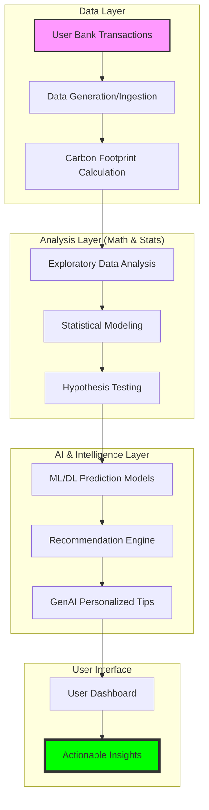

# 🌿 EcoWallet: AI-Powered Carbon & Financial Optimizer

EcoWallet is an industry-standard AI product designed to help users optimize their financial spending while minimizing their environmental impact. This project serves as a hands-on learning lab for mastering Mathematics, Statistics, Machine Learning, and Generative AI.

---

## 🏗️ Project Architecture

The following diagram illustrates the end-to-end flow of the EcoWallet system:

---

## 🗺️ Learning Roadmap & Topic Mapping

We are learning each topic by applying it directly to EcoWallet. Here is how the topics map to the project:

| Topic | Application in EcoWallet | Status |
| :--- | :--- | :--- |
| **02. Math & Stats** | Descriptive stats for spending, Probability for emission factors, Hypothesis testing for eco-impact. | 🟡 In Progress |
| **03. Data Analysis** | Advanced EDA, identifying spending trends, and carbon intensity visualization. | ⚪ Pending |
| **04. Machine Learning** | Predicting future carbon footprint using Linear Regression and Random Forests. | ⚪ Pending |
| **05. Deep Learning** | Using Neural Networks to categorize complex transaction descriptions. | ⚪ Pending |
| **06. Generative AI** | Generating personalized, natural language "Eco-Tips" for users. | ⚪ Pending |
| **07. RAG & Vectors** | Grounding AI tips in real scientific carbon databases using Vector Search. | ⚪ Pending |
| **08. Agentic AI** | Building an AI Agent that can autonomously suggest budget reallocations. | ⚪ Pending |

---

## 📂 Folder Structure

- `data/`: Raw and processed datasets (CSV, JSON).
- `src/`: Core source code.
    - `data_gen/`: Scripts for data simulation and ingestion.
    - `analysis/`: Statistical analysis and EDA scripts.
    - `models/`: ML/DL model training and inference.
    - `utils/`: Shared utility functions.
- `notebooks/`: Research and experimentation.
- `docs/`: Detailed guides for each learning module.
- `tests/`: Quality assurance for our AI logic.

---

## 🚀 Getting Started

1. **Data Generation:** Run `python src/data_gen/transaction_data.py` to create your initial dataset.
2. **Exploratory Data Analysis:** From the EcoWallet project directory, run `python src/analysis/eda_analysis.py` to print carbon-footprint descriptive statistics and emissions by category. The distribution chart is saved as `data/carbon_footprint_distribution.png`.
