# 🏛️ EcoWallet System Architecture

This document provides a high-level visual representation of the EcoWallet AI platform.

## 🗺️ System Flow Diagram

```mermaid
graph LR
    %% Data Ingestion & Processing
    subgraph "1. Data Ingestion Layer"
        A[Bank API / CSV] -->|Raw Transactions| B(Data Ingestion Service)
        B -->|Cleaned Data| C{Carbon Mapping Engine}
        C -->|LCA Factors| D[(Transaction Database)]
    end

    %% Intelligence & Analysis
    subgraph "2. Intelligence Layer"
        D --> E[Statistical Analysis Engine]
        E -->|Patterns| F[ML Prediction Models]
        F -->|Forecasts| G[Recommendation Engine]
        G -->|Optimization| H[GenAI Personalization]
    end

    %% User Experience
    subgraph "3. Presentation Layer"
        H --> I[User Dashboard]
        I --> J[Actionable Insights]
        J --> K[Financial Savings]
        J --> L[Carbon Reduction]
    end

    %% Styling
    style A fill:#f9f,stroke:#333,stroke-width:2px
    style D fill:#fff,stroke:#333,stroke-width:2px
    style J fill:#00ff00,stroke:#333,stroke-width:4px
    style L fill:#00ff00,stroke:#333,stroke-width:2px
```

## 🛠️ Component Details

| Layer | Component | Responsibility |
| :--- | :--- | :--- |
| **Ingestion** | **Data Ingestion Service** | Normalizes messy bank transaction descriptions into structured categories. |
| **Ingestion** | **Carbon Mapping Engine** | Maps categories to scientific emission factors ($kg\ CO_2/\$$). |
| **Intelligence** | **Statistical Engine** | Calculates mean, variance, and confidence intervals for user footprints. |
| **Intelligence** | **ML Prediction Models** | Forecasts future carbon output based on historical spending trends. |
| **Intelligence** | **GenAI Personalization** | Uses LLMs to translate complex data into friendly, actionable "Eco-Tips". |
| **Presentation** | **User Dashboard** | Visualizes the "Dual Bottom Line": Money Saved vs. Carbon Saved. |

---

## 🔄 Data Lifecycle

1. **Capture:** User spending is recorded in `data/transactions.csv`.
2. **Analyze:** `src/analysis/` scripts perform statistical profiling.
3. **Predict:** `src/models/` predict future impact and identify optimization points.
4. **Act:** The system suggests "Swaps" (e.g., *"Switch to local produce to save $5 and 2kg CO2"*).
